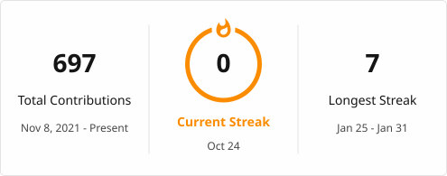

  <h1>Hi 👋, I'm Kyaiiro (pronounced kya-ro)</h1>
  <h3>A passionate hobbyist from South Africa that specifically works with backend!</h3>
  
   
  

 

- 🔭 I’m currently working on my own [manga reader](https://github.com/kyaiiro/Manga-Reader) and a [website](https://qpex.co.za) for my (and [RocketStar](https://github.com/DJenuVDM)'s) business!

- 🌱 I’m currently learning **Rust**

- 👨‍💻 All of my projects are available at [https://github.com/kyaiiro](https://github.com/kyaiiro)

- 💬 Ask me about **Discord bots, linux or python**

- 📫 How to reach me: **kyaiiro@gmail.com, or @kyaiiro on Discord (perferably discord, I don't check email)**

- ⚡ Fun fact **I have such a messed up sleep schedule yet I need to get up at a decent time every morning due to school. I should fix this...**

  

